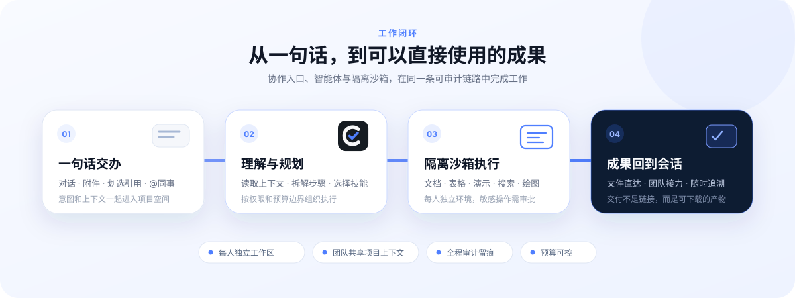
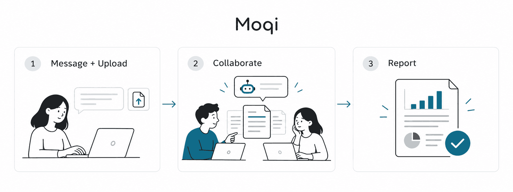
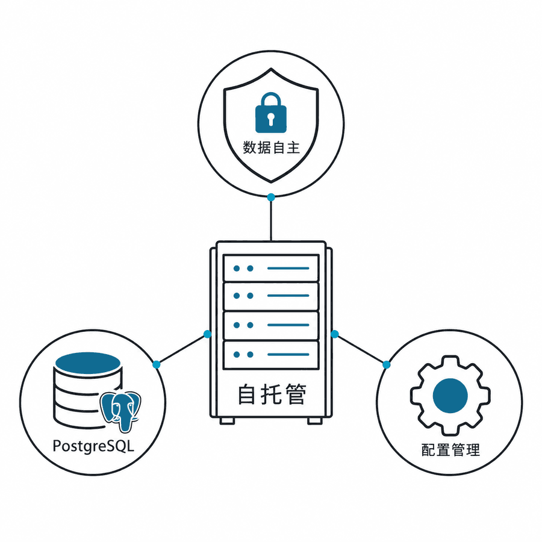

# 默契 · Moqi

### 把一项工作，从想法推进到成果。

面向中文团队的 AI 协作助手 · 自托管

简体中文 · [English](./README.md)

[开始使用](#从一项真实工作开始) · [部署](#部署与维护) · [反馈问题](https://github.com/irisfeng/moqi/issues/new)

**交代任务　→　协作推进　→　交付成果**

默契 把会话、工作材料和项目协作放在一起。你说明目标、提供材料，AI 在工作区中处理任务；你和同事继续补充、修改、核对，让结果成为可以交付的文档、表格或演示。

基于开源 [QM](https://github.com/yc-software/qm) 持续定制，围绕中文团队的日常工作完善体验。

## 从一项真实工作开始

### 01　把目标和材料交代清楚

在新建聊天中描述任务，上传材料，或输入 `/` 选择技能。精选场景提供工作起点，点击后先放入草稿，由你调整并发送。

> 根据这份项目材料，整理一份汇报提纲：说明进展、关键风险，以及需要负责人决策的事项。缺少依据的地方请标出来。

### 02　和同事一起推进

用项目组织相关会话与共享上下文，通过 `@` 提及和引用回复衔接讨论。部门文档共享材料，项目管理维护材料版本及提交、确认、退回流程。

> 汇总本项目的现有材料，列出缺失项和待确认问题，方便相关同事补充。

### 03　修改、核对，再交付

办公技能在沙箱中处理文档、表格、演示和流程图。你可以继续提出修改，核对来源与关键数据，再使用成果。具体产物取决于部署中的技能、工具和模型配置。

> 把这份分析整理成汇报演示，保留数据来源，将结论和待确认事项分开表达。

## 从第一次完成，到持续用好

成长手册围绕真实工作展开：**明确目标 → 提供材料 → 生成成果 → 提出修改 → 验收结果**。

精选场景帮助找到值得做的工作；积分和手绘徽章记录已完成的实践。任务何时发送、成果是否通过，始终由你决定。提醒可以关闭，练习不要求连续打卡。

## 团队可用，也便于管理

| 工作需要       | 默契 提供的支持                        |
| :------------- | :------------------------------------- |
| 材料有来处     | 文件版本、材料校验状态与人工确认流程   |
| 协作有上下文   | 项目会话、成员提及、共享文档与材料版本 |
| 任务有工作空间 | 独立工作区与沙箱中的办公工具           |
| 使用有边界     | 模型配置、凭据管理、预算控制与运行记录 |
| 部署可掌握     | 自托管服务、持久化状态与组织层配置     |

会话状态和文件保存在部署环境中。调用外部模型、搜索或其他工具时，相关输入可能发送给对应服务；实际数据流向由配置和供应商政策决定。

## 部署与维护

准备 Linux 与 Docker、管理机 Node.js ≥ 24.15.0 / npm ≥ 11.10.0，以及可用的模型服务凭据。容量按实际并发任务、沙箱和 OCR 负载评估。

**首次部署**：Moqi 从本仓库的源码部署。npm 上的 `@yc-software/qm` 和它拉取的镜像是上游 QM 的发行版，用它部署得到的是 QM，不是 Moqi。先按 [部署说明](./deployment.md) 配置认证、模型、沙箱、持久目录和 HTTPS，再按 [英文 README 的部署步骤](./README.md#deploy-moqi) 用 `--build-from .` 从源码构建全部镜像，并在构建 Web UI 镜像前写入版本号和更新内容。国内模型供应商模板见 [`deploy/layers/qm-cn/providers/`](./deploy/layers/qm-cn/providers/README.md)，单机配置示例见 [`qm.config.jsonc.example`](./deploy/layers/qm-cn/deploy/qm.config.jsonc.example)。

**组织专属内容**：真实配置、运维手册和部署记录不在本仓库。把它们放在 `deploy/layers/qm-cn/private/`，该目录已被忽略，可作为独立的私有仓库管理。

<strong>技术栈与上游关系</strong>

核心使用 TypeScript / Fastify，Web UI 使用 Lit / Vite，核心状态使用 Postgres。

上游 Slack 集成使用 Bolt，由核心启动和监督；中文 Web 部署不要求启用 Slack。

本仓库基于开源 [QM](https://github.com/yc-software/qm) 定制，核心与上游存在差异。与 Moqi 无关的通用问题，可以按上游的贡献指南直接向上游反馈。

## 文档导航

| 你想做什么         | 从这里开始                                              |
| :----------------- | :------------------------------------------------------ |
| 配置并部署实例     | [部署说明](./deployment.md)                             |
| 接入国内模型供应商 | [供应商模板](./deploy/layers/qm-cn/providers/README.md) |
| 了解组织层目录     | [组织层说明](./deploy/layers/README.md)                 |
| 参与开发           | [开发约定](./AGENTS.md)                                 |

## 参与与反馈

欢迎在本仓库提交 [问题反馈](https://github.com/irisfeng/moqi/issues/new)，附上版本、复现步骤、预期与实际结果。界面改动请提供可查看的效果，截图隐藏凭据和无关个人信息。

感谢 [QM](https://github.com/yc-software/qm) 及其贡献者。源代码遵循 [MIT License](./LICENSE)。
